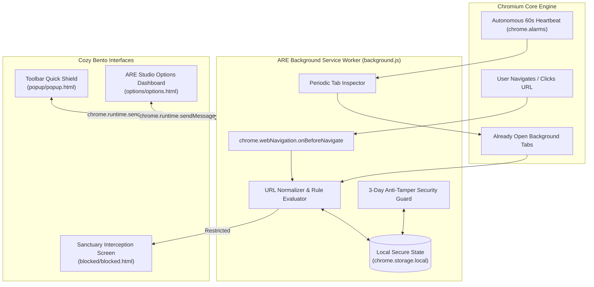

# 🌱 ARE (Autonomous Restrictor Engine) v2.0
> **A Cozy Cognitive Shield, Unbreakable 3-Day Focus Pledge & Mindful Intent Audit Protocol**

[](#)
[-blue.svg)](#)
[](#)
[](#)

---

## 💭 The Creator's Note: Built With AI, Directed By Human Will

> *"I am just a person who thinks what he wants. I know that I am in a modern era, yet I am still executing the way I want.*
>
> *I have shame, but I still don't have shame.*
>
> *Yes, this entire system was co-engineered and generated with an AI partner. We live in an era where trillion-dollar corporations deploy military-grade behavioral psychology and recommendation algorithms to hijack our dopamine, our evenings, and our attention. I don't feel shame for admitting that my willpower is human and fallible. And I have no shame in using modern artificial intelligence to construct an uncompromising, automated fortress around my mind.*
>
> *This is my weapon for peace."*

---

## 🌿 What Is ARE?

**ARE (Autonomous Restrictor Engine)** is a Manifest V3 browser extension for Chromium browsers (Google Chrome, Brave, Microsoft Edge, Opera). 

It is not just another website blocker that you can dismiss with a simple toggle when late-night cravings strike. ARE is an **autonomous cognitive shield** anchored by a **Mandatory 3-Day Commitment Protocol**:

Once you restrict a link, it is sealed for **72 hours**. You have **zero access** to revoke, disable, toggle off, or delete that restriction during this window. After 3 days, when you visit the platform, ARE prompts you with a mindful check-in: continue for another 3 days, or undergo a **7-Step Mindful Intent Audit** that collects real psychological and behavioral reflection data before you can proceed.

---

## 🧱 The Built System: How It Works & What We Use



### 1. The Technology Stack
* **Manifest V3 Architecture:** Built entirely according to modern Chromium extension standards using asynchronous background Service Workers (`background.js`) rather than bloated background pages.
* **Pure Vanilla JavaScript (ES2024):** Zero external libraries, zero npm packages, zero React/Vue overhead. Boots instantly, uses negligible RAM (< 15MB), and runs at lightning speed.
* **Dual-Layer Interception:**
  * **Top-Level Navigation Hook (`chrome.webNavigation.onBeforeNavigate`):** Intercepts network requests before DOM rendering begins, immediately redirecting restricted destinations to [`blocked/blocked.html`](file:///c:/Lil-Projects/ARE/blocked/blocked.html).
  * **Autonomous 60-Second Tab Watcher (`chrome.alarms`):** Solves the classic bypass where a user leaves WhatsApp or Instagram open in a tab before curfew. Every 60 seconds, ARE audits all active browser tabs. When 9:00 PM strikes, already-open tabs are autonomously sealed.
* **Overnight 24-Hour Cycle Math:** Calculates cross-midnight windows (`21:00 → 07:00`) seamlessly by attributing early-morning hours to the schedule armed the previous evening (`(currentDay + 6) % 7`).
* **Design System (Warm Linen & Sage):** Apple Bento Grid architecture with warm parchment backgrounds (`#faf7f2`), soft cream cards (`#ffffff`), forest sage (`#3f6212`), honey amber (`#b45309`), and cozy typography.

---

## 🔒 The 3-Day Mandatory Commitment Protocol (72-Hour Pledge)

Most site blockers fail because when nighttime fatigue sets in, the user clicks "Disable" or deletes the extension. ARE removes that illusion of optionality.

```text
[Add Link] ───► [72-Hour Mandatory Lock] ───► [3 Days Complete] ───► [Mindful Check-in]
                     │                                                      │
                     ├─ Toggle Switch: DISABLED                             ├─ "Yes" ──► Lock +3 Days
                     ├─ Delete Button: LOCKED                               └─ "No"  ──► 7-Step Audit
                     └─ Background: TAMPER-PROOF
```

### 1. Sealing The Lock
Whenever any link is restricted (via the Quick Toolbar Popup or the ARE Studio Rule Forge):
* It is stamped with `lockedUntil = Date.now() + 72 hours`.
* The background service worker enforces strict immunity: any message attempting to toggle `enabled: false` or send `DELETE_RULE` is rejected with an explicit remaining time countdown.

### 2. The 3-Day Milestone Check-in
When 72 hours expire, ARE does not automatically unblock the site. Instead, the next time you navigate to that destination:
1. ARE intercepts the tab and displays the **Milestone Review Screen**:
   > **"Your 3-day restriction period has ended. Do you want to continue the restriction?"**
2. **If YES:** The restriction is immediately renewed for **another 3-day lock** (`+72 hours`).
3. **If NO:** ARE presents the **7-Step Mindful Intent Audit**.

---

## 📝 The 7-Step Mindful Intent Audit (Capturing Actual Data)

To prevent mindless relapse, choosing "No" requires conscious reflection. ARE walks you through 7 targeted questions to collect actual psychological data:

| Step | Dimension | Purpose & Captured Data |
| :---: | :--- | :--- |
| **1** | **Core Removal Intent** | Confirms whether you want permanent removal, a temporary 1-hour pass, or are acting on impulse. |
| **2** | **Root Task & Trigger** | Pinpoints the real trigger: Essential work, urgent communication, muscle memory, boredom, or procrastination. |
| **3** | **Internal Emotional State** | Self-awareness audit: Calm and centered, fatigued/depleted, anxious/stressed, or restless. |
| **4** | **Realistic Time Budget** | Estimates honest exposure: `<5 mins`, `15–30 mins`, `45–60 mins`, or `unpredictable`. |
| **5** | **Distraction & Scroll Risk** | Probabilistic assessment of falling into endless feeds or dopamine loops (`Low`, `Moderate`, `High`, `Inevitable`). |
| **6** | **Restorative Offline Action** | Prompts an immediate healthy substitute: Drink water/tea, step outside for fresh air, read a book, or wind down for sleep. |
| **7** | **Final Conscious Choice** | The verified action: **`Re-arm 3 Days`**, **`1-Hour Focus Grace Pass`** (auto-relocks after 60m), or **`Permanent Removal`**. |

All submissions are permanently recorded in the **Reflection & Intent Audit Vault** in ARE Studio so you can analyze your psychological trends and behavioral triggers over time.

---

## ⚡ Core Features

* **🌙 Autonomous 9:00 PM Bedtime Curfew:**
  * Pre-configured targets: `web.whatsapp.com`, `instagram.com`, `youtube.com`, `x.com`, `reddit.com`.
  * Runs nightly from `21:00` to `07:00` with automated tab inspection.
* **☕ Focus Sprint Lock:**
  * Quick-launch deep work chips (`25m`, `45m`, `60m`, `2h`) with a live countdown display.
* **🛡️ Strict Mode Armor:**
  * Prevents modifying rules or disabling focus sprints during active curfew hours.
* **📊 Reflection & Intent Audit Vault:**
  * View, analyze, or clear logged reflection history and intent data.
* **🍱 Apple Bento Grid Studio:**
  * Live ticking telemetry clock, active protocol pills, and modular restriction forges.

---

## 📦 How Anyone Can Install & Use This

Anyone can install and run ARE in **under 60 seconds** on any Chromium-based browser (Google Chrome, Brave, Microsoft Edge, Opera):

### Step 1: Clone or Download The Repository
Open your terminal (or Command Prompt) and run:
```bash
git clone https://github.com/ursabastin/ARE.git
```
*(Or click **Code → Download ZIP** on GitHub and extract the folder to your computer).*

### Step 2: Open Extensions in Your Browser
Open your browser and enter the extension management URL in your address bar:
* **Google Chrome / Brave:** `chrome://extensions/`
* **Microsoft Edge:** `edge://extensions/`

### Step 3: Enable Developer Mode
Look for the **"Developer mode"** toggle switch (usually located in the top-right corner of the Extensions page) and turn it **ON**.

### Step 4: Load Unpacked Extension
1. Click the **"Load unpacked"** button (top-left corner).
2. Select the `ARE` folder (the directory containing `manifest.json`).
3. Click **Select Folder**.

### Step 5: Pin and Enjoy Sanctuary
1. Click the puzzle-piece icon in your browser toolbar and **pin ARE (🌱)**.
2. Click the icon to view your Quick Shield, or click **"Open ARE Studio ☕"** to configure your 3-day rules, inspect your reflection logs, and customize your curfew hours.

---

## 📂 Project Directory Structure

```text
ARE/
├── manifest.json         # Manifest V3 extension configuration
├── background.js         # Core Aether-Chassis Engine & Service Worker
├── README.md             # The story, philosophy, and documentation
├── icons/                # Extension branding icons (16px, 48px, 128px)
├── popup/
│   ├── popup.html        # Toolbar Quick Shield popup
│   ├── popup.css         # Cozy warm styling & compact cards
│   └── popup.js          # Tab detector & quick 3-day pledge lock
├── options/
│   ├── options.html      # Full Apple Bento Grid Studio Dashboard
│   ├── options.css       # Studio styles, tokens, and telemetry pods
│   └── options.js        # Rule Forge, Audit Log Renderer, and State Controller
└── blocked/
    ├── blocked.html      # Mindful Sanctuary Interception Screen & 7-Step Wizard
    ├── blocked.css       # Cozy Linen & Sage theme styling
    └── blocked.js        # 3-Day countdown, check-in evaluator & audit wizard
```

---

## 📜 License & Credit

Built with passion, human intention, and AI co-engineering.  
Licensed under the [MIT License](LICENSE) — free to use, modify, and share to protect human focus and peace of mind.
